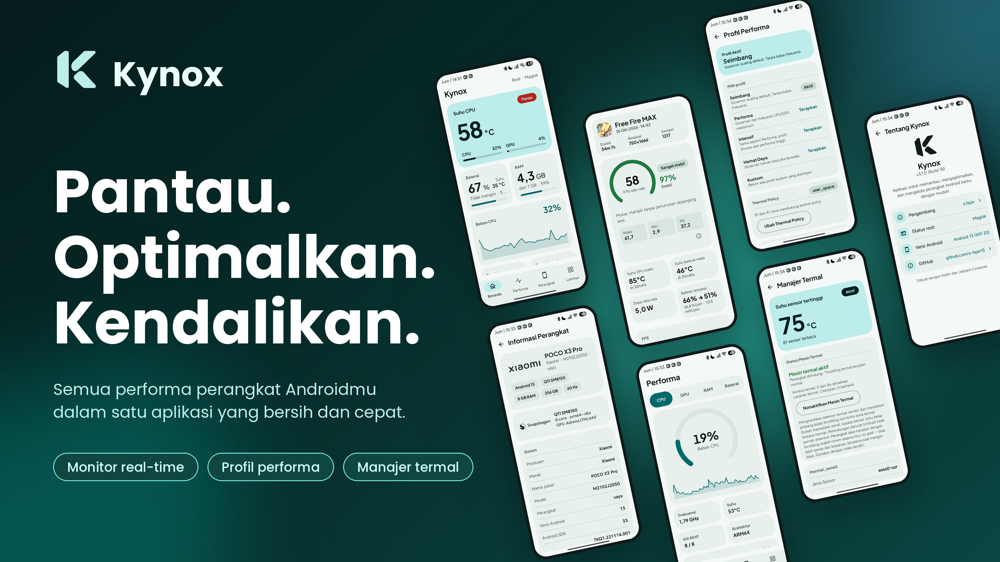

# Kynox

Aplikasi Android untuk memantau dan mengatur performa perangkat: suhu, beban CPU dan GPU, baterai, refresh rate, profil performa, dan perekaman sesi game.

Pemantauan berjalan tanpa root. Hampir semua fitur yang mengubah pengaturan sistem membutuhkan root (Magisk, KernelSU, atau APatch). Fitur yang tidak didukung kernel atau perangkat ditandai "Tidak didukung" di layarnya, tidak dipalsukan.

## Tampilan

  

## Fitur

### Pemantauan

- **Beranda**: suhu CPU, beban CPU dan GPU, RAM, penyimpanan, dan swap.
- **Monitor**: grafik waktu nyata untuk CPU, GPU, dan baterai. Bila monitor latar belakang dinyalakan di Pengaturan, riwayat 30 menit terakhir disimpan di perangkat.
- **Perangkat**: SoC, GPU, layar, RAM, penyimpanan, versi kernel, status SELinux, patch keamanan, build fingerprint, dan status root.
- **Widget** layar utama (5 jenis): ringkasan, baterai, baris ringkas, status pengisian, dan tombol overlay. Semuanya dibaca tanpa root.

### Performa

- **Profil performa**: Performa, Intensif, Hemat Daya, dan satu profil kustom yang diisi dari kondisi perangkat saat ini. Setelah diterapkan, hasil tiap parameter ditampilkan. Ada tombol reset ke kondisi awal dan opsi menerapkan profil saat boot.
- **CPU dan GPU**: governor dan frekuensi.
- **Thermal**: status mesin termal dan thermal policy per zone.
- **Refresh rate per aplikasi**: dicoba beberapa cara berurutan dan hasilnya dicek terhadap mode layar yang benar-benar aktif. Tanpa root dipakai overlay 1 piksel yang meminta mode layar tertentu.

### Daya

- **Baterai dan pengisian**: kapasitas, arus, daya, tegangan, suhu, dan info charger.
- **Batas pengisian**: menjeda pengisian di persentase pilihan dan melanjutkannya sedikit di bawah batas itu. Bergantung pada node sysfs yang disediakan kernel.
- **Fast charging**: menaikkan batas arus lewat skrip root yang berjalan di latar belakang. Ada mode lanjutan yang lebih berisiko dan dipisah dengan peringatan tersendiri.
- **Notifikasi pengisian** (opsional): level, arus, daya, tegangan, dan suhu, hanya muncul saat charger tersambung.

### Sistem

- **Blokir iklan (hosts)**: memasang modul `kynox_hosts` yang menimpa `/system/etc/hosts`. Daftar domain diunduh dari sumber yang bisa kamu atur, dengan daftar putih dan hitam sendiri. Mendukung Magisk, KernelSU, dan APatch.
- **Debloat**: menonaktifkan aplikasi bawaan (`pm disable-user`), bisa diaktifkan kembali dari layar yang sama. Paket penting sistem dilindungi dan tidak bisa dipilih.
- **Bersihkan RAM dan cache**: mode aman dan agresif. Dengan root, aplikasi pihak ketiga yang berjalan dihentikan, kecuali launcher, keyboard, layanan aksesibilitas, dan Kynox. Tanpa root, efeknya terbatas pada yang diizinkan Android.
- **Proses**: daftar proses berjalan dan tombol hentikan.
- **Panel cepat**, **Root**, dan **Kontrol sistem** (CPU, GPU, termal, baterai dalam satu layar).

### Mode performa dan rekam sesi

- **Mode performa**: menerapkan profil saat game dibuka dan mengembalikan profil sebelumnya saat ditutup. Tiap game bisa diberi profil sendiri.
- **Deteksi otomatis**: layanan yang memantau aplikasi di depan dan menyalakan mode performa untuk game di pustaka.
- **Overlay performa**: FPS dan metrik lain di atas aplikasi. Ukuran dan transparansinya bisa diatur.
- **Rekam sesi**: mencatat FPS, frekuensi CPU dan GPU, suhu, dan daya tiap detik. Laporannya menampilkan ringkasan, penurunan FPS, dan grafik. Bisa diekspor sebagai PNG, PDF, atau CSV.
- **Riwayat dan perbandingan sesi**, serta **pustaka game**.

### Alat

- **Automation rules**: profil dan refresh rate per aplikasi, dikembalikan saat aplikasi ditutup.
- **Network monitor**, **SELinux monitor**, **Snapshot** kondisi perangkat, dan **Diagnostics**.
- **Command console**: menjalankan perintah shell. Perintah yang hampir pasti merusak (misalnya `rm -r /` atau `mkfs`) ditolak, dan perintah berisiko meminta konfirmasi.

### Aplikasi

- **Log** semua perubahan yang dibuat Kynox.
- **Cadangan dan pulihkan**: ekspor dan impor pengaturan, aturan automation, daftar game beserta profilnya, profil kustom, dan refresh rate per aplikasi. Impor hanya menulis konfigurasi Kynox, tidak menjalankan perintah sistem.
- **Pengaturan**: tema terang, gelap, atau ikut sistem, interval penyegaran, konfirmasi sebelum menerapkan, notifikasi, dan overlay.

## Cara Kynox mengubah sistem

Semua operasi root lewat satu lapisan (`RootExecutor`) dengan batas waktu. Nilai sistem yang diubah dicadangkan dulu, ditulis, dibaca ulang untuk memastikan berlaku, lalu dicatat di Log. Tiap fitur yang menyentuh nilai sistem punya tombol kembali ke kondisi awal.

## Izin

| Izin | Dipakai untuk |
|---|---|
| `INTERNET` | Mengunduh daftar hosts, hanya saat kamu menekan Perbarui daftar. Tidak ada unduhan di latar belakang. |
| `ACCESS_NETWORK_STATE` | Network monitor. |
| `KILL_BACKGROUND_PROCESSES` | Bersihkan RAM tanpa root. |
| `WRITE_SETTINGS` | Mengubah kecerahan dari Panel cepat. Diminta lewat layar pengaturan sistem. |
| `PACKAGE_USAGE_STATS` | Mengetahui aplikasi di depan bila pembacaan lewat root tidak tersedia. |
| `SYSTEM_ALERT_WINDOW` | Overlay FPS dan metrik. |
| `POST_NOTIFICATIONS` | Notifikasi layanan. |
| `FOREGROUND_SERVICE`, `FOREGROUND_SERVICE_SPECIAL_USE` | Monitor, rekam sesi, deteksi otomatis, dan notifikasi pengisian. |
| `RECEIVE_BOOT_COMPLETED` | Menerapkan profil dan menjalankan layanan setelah boot. |

Satu-satunya akses jaringan di kode adalah unduhan daftar hosts. Tidak ada pustaka analitik atau pelaporan crash.

## Batasan

- Node sysfs berbeda di tiap kernel. Batas pengisian, fast charging, kontrol GPU, dan kontrol termal hanya bekerja bila kernel menyediakan node yang dibutuhkan.
- Pembacaan FPS memakai `dumpsys SurfaceFlinger`, yang bukan API publik. Pada ROM tertentu hasilnya bisa tidak tersedia, dan rekam sesi menampilkan FPS sebagai tidak didukung.
- Blokir iklan bekerja di tingkat domain. Iklan yang disajikan dari domain yang sama dengan kontennya, misalnya video YouTube, tidak terblokir, dan aplikasi yang memakai DNS sendiri melewati daftar hosts. Jangan pakai bersamaan dengan modul pemblokir hosts lain.
- Di KernelSU dan APatch, modul hosts butuh mekanisme mount modul yang aktif. KernelSU versi baru memerlukan metamodule mount.
- Dukungan hosts di KernelSU dan APatch baru ditulis dan belum diuji di perangkat.
- Kynox dikembangkan dan dicoba di POCO X3 Pro (vayu, Android 13). Di perangkat lain, perilakunya bisa berbeda.

## Teknologi

Kotlin dan Jetpack Compose (Material 3), `minSdk` 26, `targetSdk` 34.

## Pengembang

s.fajar
